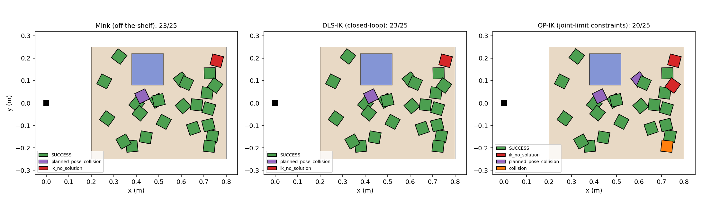
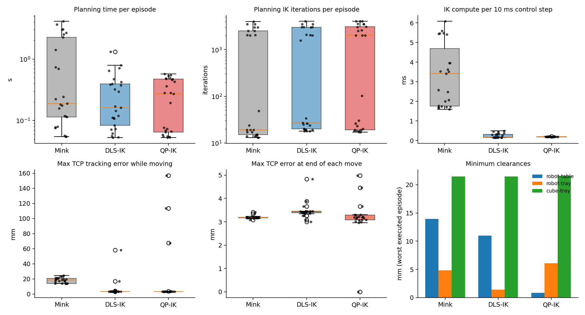
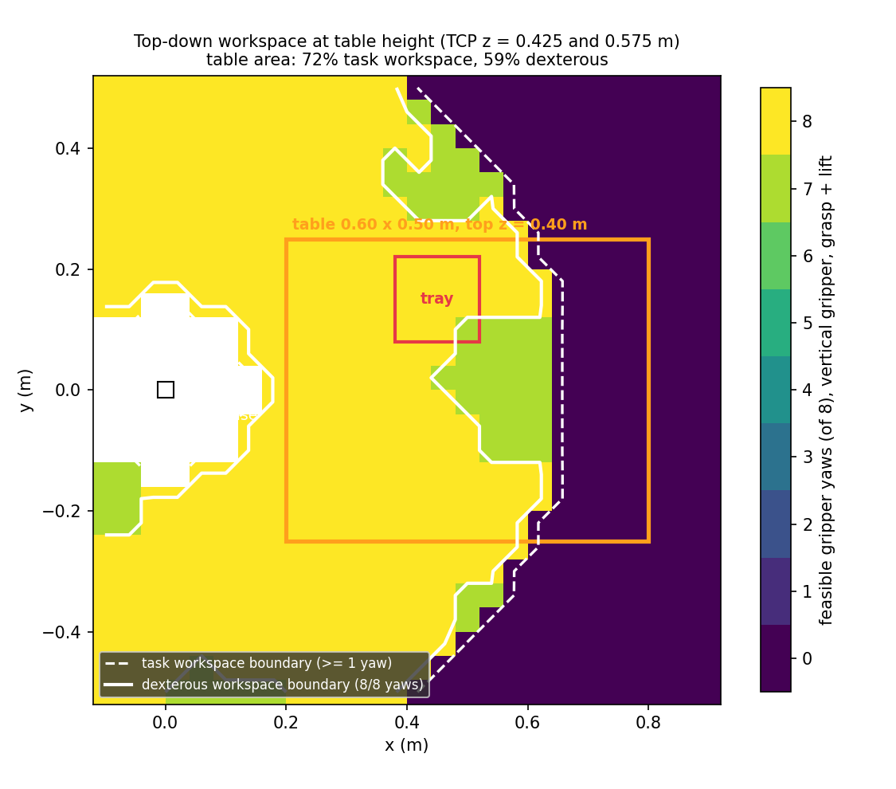

# Franka Panda Pick-and-Place with Three IK Methods (MuJoCo)

Tutorial 4: Pick and Place of Objects. A Franka Emika Panda picks a randomly placed cube from a table and places it in a tray, using three inverse-kinematics methods that are compared on identical seeded episodes:

| Method | Script | Idea |
| --- | --- | --- |
| Off-the-shelf: [mink](https://github.com/kevinzakka/mink) | `scripts/pick_place_batch_cube.py`, `scripts/compare_ik.py --methods mink` | Differential IK solved as a QP by mink, open-loop reference |
| Damped Least Squares (closed-loop) | `scripts/pick_place_dls.py`, `scripts/compare_ik.py --methods dls` | `qdot = (JᵀJ + λI)⁻¹ Jᵀ xdot` with adaptive λ and a null-space posture term |
| QP with joint-limit constraints | `scripts/pick_place_qp.py`, `scripts/compare_ik.py --methods qp` | `min ½ qdotᵀ H qdot + cᵀ qdot  s.t.  G qdot ≤ h` with joint-position and joint-velocity limits |

Robot model: [MuJoCo Menagerie, franka_emika_panda](https://github.com/google-deepmind/mujoco_menagerie/tree/main/franka_emika_panda).

## Results (25 episodes, seed 0, identical for all methods)

| Metric | Mink (off-the-shelf) | DLS-IK (closed-loop) | QP-IK (joint-limit constraints) |
| --- | --- | --- | --- |
| Success rate | 92% | 92% | 80% |
| Mean planning time (s) | 1.041 | 0.300 | 0.262 |
| Planning IK iterations / episode (mean) | 1144 | 1254 | 1621 |
| IK iterations / converged waypoint (mean) | 2.6 | 3.6 | 4.1 |
| IK compute per control step (ms) | 3.33 | 0.25 | 0.20 |
| Min robot-table clearance (mm) | 13.9 | 11.0 | 0.9 |
| Min robot-tray clearance (mm) | 4.8 | 1.4 | 6.1 |
| Min cube-tray clearance (mm) | 21.4 | 21.5 | 21.6 |
| Min joint-limit margin (rad) | 0.486 | 0.480 | 0.481 |
| Joint-limit hits (steps) | 0 | 0 | 0 |
| Velocity-limit violations (steps) | 0 | 0 | 0 |
| Peak joint speed / limit | 0.72 | 0.43 | 0.43 |
| Max TCP tracking lag (mm) | 24.7 | 58.4 | 157.0 |
| Max settled TCP error (mm) | 3.4 | 4.8 | 5.0 |
| Extra settle time / episode (s, mean) | 0.00 | 0.02 | 0.05 |
| Failures | planned_pose_collision: 1, ik_no_solution: 1 | planned_pose_collision: 1, ik_no_solution: 1 | ik_no_solution: 2, planned_pose_collision: 2, collision: 1 |

Without the grasp mitigations (alternate yaw, tilted approach) Mink succeeds in 10/25 episodes (`results/baseline_no_mitigation`).





Report: `docs/report.pdf`. Video: (add link).


## 1. Setup

```bash
# Python 3.10+
pip install -r requirements.txt

# Robot model
git clone https://github.com/google-deepmind/mujoco_menagerie.git
```

The scenes in `scene/` load the Panda from an absolute path. If your `mujoco_menagerie` is not at `/home/iitgn-robotics/Pant/mujoco_menagerie`, edit the two paths near the top of `scene/pick_place_cube_scene.xml` and `scene/pick_place_scene.xml`.

Every script finds `scene/` by itself, so run them from anywhere:

```bash
python3 scripts/pick_place_dls.py
python3 scripts/compare_ik.py --methods mink --episodes 4 --viewer
```

On a machine without a display, use `MUJOCO_GL=egl` for the scripts that render images or video.

## 2. Scripts and the tutorial sections they cover

| Section | Script | What it does |
| --- | --- | --- |
| FK / IK warm-up | `inspect_model.py`, `fk_panda.py`, `IK_panda.py`, `franka_panda.py` | Model inspection, forward kinematics, a first mink IK solve |
| 5. Workspace | `workspace_reachable.py` | Reachable workspace: 30,000 random joint samples, hand position cloud |
| 5. Workspace | `workspace_dext.py` | Dexterous workspace: 500 points × 16 yaws with mink |
| 5–6. Workspace + table | `workspace_table_map.py` | Top-down task and dexterous workspace at table height with the table and tray drawn on top |
| 7. Environment | `scene/pick_place_cube_scene.xml` | Panda, table, 5 cm cube (free joint), fixed open tray |
| 7. Environment check | `verify_pick_place.py` | Checks that the task poses are reachable and collision-free at 16 yaws (ball scene) |
| 9. Mink, single run | `pick_place.py` | One pick and place with the viewer (ball scene) |
| 8–10. Mink, batch | `pick_place_batch_cube.py` | Randomized cube episodes with per-episode logs |
| 11. Failure analysis | `failure_analysis_cube.py` | Reproduces and renders every failure, tests the mitigations, collision-margin sweep |
| 12. DLS-IK | `pick_place_dls.py` | Closed-loop DLS, single run with the viewer |
| 12. QP-IK | `pick_place_qp.py` | Closed-loop QP IK with joint-limit constraints, single run with the viewer |
| 13. Comparison | `compare_ik.py` | All three methods on identical seeds, all Section 10 + 13 metrics, plots |
| 15. Video | `record_video.py` | About 1 minute per method, captioned |

## 3. Reproducing the results

```bash
S=scripts

python3 $S/workspace_table_map.py --out workspace_table_map               # ~5 min
python3 $S/compare_ik.py --episodes 25 --seed 0 --out results             # ~10 min
python3 $S/failure_analysis_cube.py --skip-stress                         # snapshots
MUJOCO_GL=egl python3 $S/record_video.py --episodes-list 0 6 10 13        # ~3 min video
```

Useful options:

- `compare_ik.py --methods dls qp`: subset of methods. `--no-mitigation`: top-down grasp only (baseline). `--viewer`: watch the episodes.
- `pick_place_qp.py --joint-limit 3 -0.05 0.05`: add a software joint limit to see QP redistribute motion while DLS can only clip (works in `pick_place_dls.py` too).
- `pick_place_dls.py --cube-x 0.72 --cube-y 0.0`: an out-of-reach target, to see the adaptive damping.

## 4. Logged per episode (`results/<method>/episodes.csv`)

Initial cube pose (x, y, yaw), success, failure reason and phase, grasp used (top-down, alternate yaw, tilted approach), planning time, IK iterations (per episode and per waypoint), IK compute per control step, minimum robot–table, robot–tray and cube–tray clearance, minimum joint-limit margin, joint-limit hits, joint-velocity violations against the Panda datasheet limits, peak and settled TCP tracking error, final cube pose and tilt.

Failure reasons: `ik_no_solution`, `planned_pose_collision`, `collision`, `cube_tray_collision`, `cube_disturbed`, `grasp_slip`, `dropped_in_transit`, `missed_tray`.

## 5. Repository layout

```
scene/            task scenes (include the Menagerie scene.xml)
scripts/          all code (see table above)
results/          comparison logs, summary table, plots
results/workspace workspace maps
results/failures  failure snapshots and states (Section 11)
docs/             report (PDF) and figures
video/            demonstration video
```

## 6. Notes

- TCP = centre of the fingertip pads, 0.103 m below the `hand` body origin.
- Clearances are exact point-to-box signed distances from points sampled on the robot's collision meshes, so they do not depend on the MuJoCo version (`mj_geomDistance` on meshes differs between versions).
- `scene/table.xml` is the original table design (top x 0.10–0.70 m). It was moved +0.10 m in x because links 1 and 2 hit its near edge; see the report.
